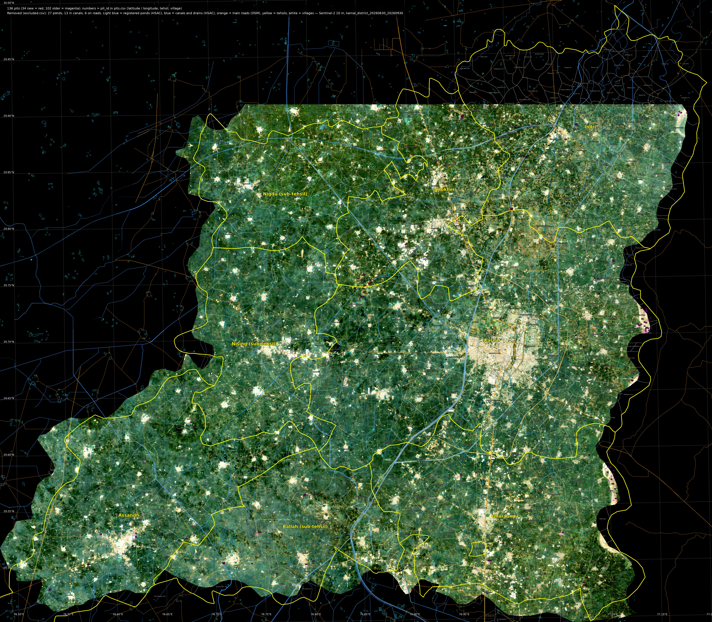
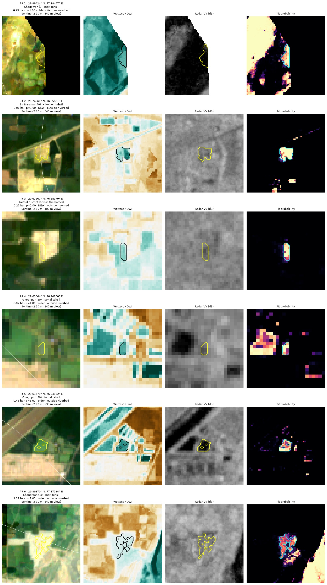
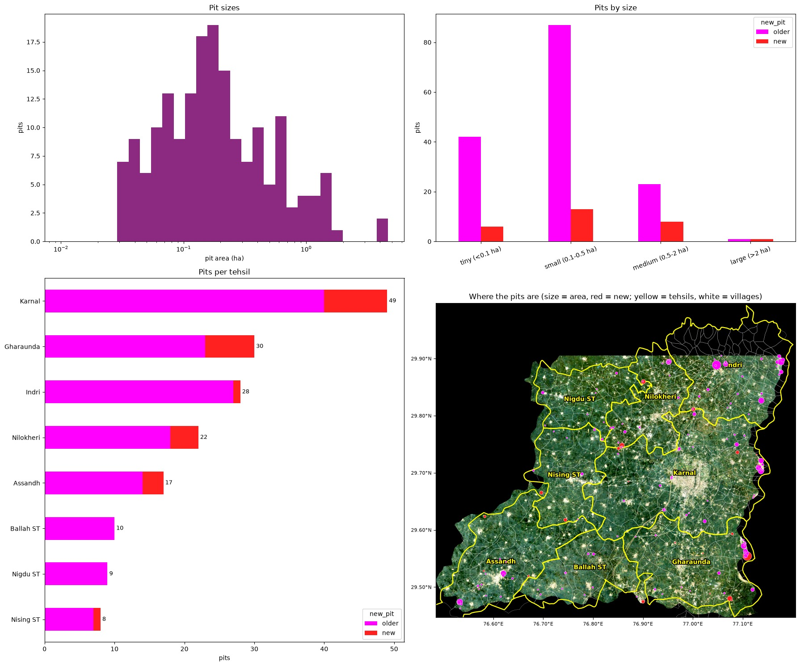
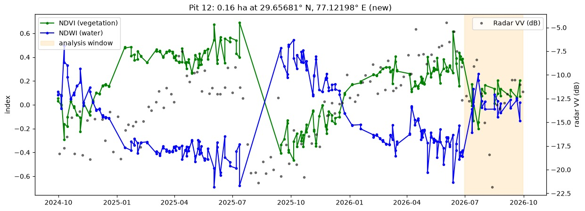
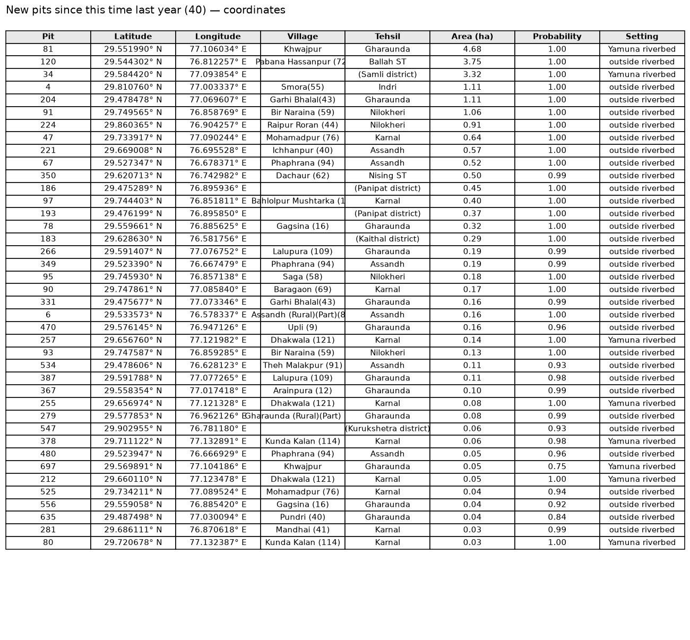
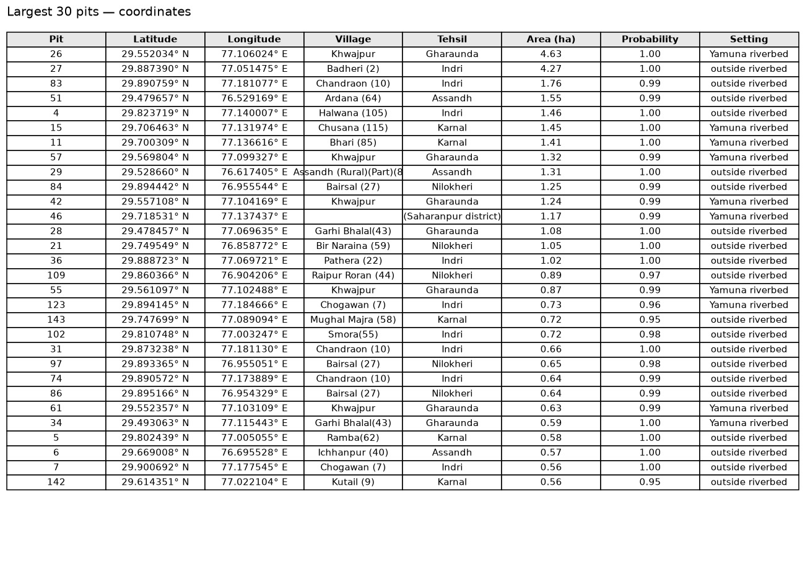

# Karnal pit detection — sand, mining and brick-kiln pits from free satellite data

Finds excavation pits — including small ones — in Karnal district, Haryana (India) using only free data:
Sentinel-2, Sentinel-1, Dynamic World, building maps and AlphaEarth AI embeddings, processed in
Google Earth Engine and at full 10 m detail in Python.

## Results — Karnal district, 30 June to 30 September 2026

| | Pits | Area |
|---|---:|---:|
| Outside the Yamuna riverbed | 93 | 22 ha |
| In the Yamuna riverbed | 34 | 21 ha |
| **Total in Karnal** | **127** | **43 ha** |
| New since the same months of 2025 | 31 | |
| Removed: registered ponds (HSAC pond register) | 24 | 5 ha |
| Removed: likely village ponds (water next to a village) | 1 | 0 ha |
| Removed: in canals and drains (4 Augmentation Canal, 4 NBK Link, 1 Samora Drain, 1 WJC Main Branch, 1 Sirsa Branch) | 11 | 1 ha |
| Removed: on roads and highways (6 Karnal Ring Road) | 6 | 1 ha |
| Just across the district border (Panipat 3, Saharanpur 2, Samli 2, Kaithal 1, Kurukshetra 1) | 9 | 3 ha |

By size: 44 tiny (< 0.1 ha), 54 small (0.1–0.5 ha), 27 medium (0.5–2 ha), 2 large (> 2 ha).
2,588 km² analysed with 88 Sentinel-2 and 24 Sentinel-1 scenes. Removed detections are listed in
[`excluded.csv`](results/karnal_2026-06-30_to_2026-09-30/excluded.csv) with the reason and the pond, canal or road, and are not counted above.
The analysis area is FAO's 2015 outline of Karnal, which does not match today's boundary exactly (see
Limitations), so the 9 pits found just across the border are listed with their own district and not
counted for Karnal.

### Pits by tehsil

| Tehsil | Pits | Area (ha) | New pits |
|---|---:|---:|---:|
| Karnal | 39 | 14.1 | 9 |
| Gharaunda | 29 | 13.4 | 9 |
| Nilokheri | 17 | 4.0 | 7 |
| Assandh | 13 | 3.6 | 3 |
| Ballah (sub-tehsil) | 12 | 1.9 | 1 |
| Indri | 11 | 5.1 | 1 |
| Nising (sub-tehsil) | 4 | 1.1 | 1 |
| Nigdu (sub-tehsil) | 2 | 0.1 | 0 |
| **Total** | **127** | **43.3** | **31** |

Villages with the most pits are in [`pits_by_village.csv`](results/karnal_2026-06-30_to_2026-09-30/pits_by_village.csv).

**Registered ponds, canals and roads are removed.** Every detection lying in a water body of the Haryana
pond register (HSAC Pond MIS, see below), in a canal or drain (Irrigation Department network from HSAC)
or on a road or highway (OpenStreetMap, including roads under construction such as the Karnal Ring
Road) is taken out of the pit list and written to `excluded.csv` with the reason and the pond, canal
or road. The model is trained with registered ponds as "not pit" examples, and road and canal pixels
are never used as pit examples. In the
previous version of these results 331 of the 664 detected "pits" — about half — lay in registered ponds.

**Treat these as candidates to verify, not confirmed pits.** There is no ground truth yet, so the pit
threshold is the default 0.6, and pits whose average probability (`prob_mean`) is below 0.65 are
dropped (`MIN_PIT_PROB` in the notebook, `minPitProb` in the Earth Engine script). The gallery shows plausible pits (for example pit 2, a new 1 ha wet, bare
patch at Bir Naraina, and pit 6, a 1.3 ha bare excavation at Chandraon) but also doubtful ones: a strip
at the edge of the analysis area in the Yamuna bed (pit 1), a bare field strip (pit 3), a tiny patch
among trees (pit 4) and a water body beside a canal that may be an unregistered pond (pit 5).
Labelling a few dozen examples (below) is the way to fix these.

| Gallery (10 m view · water · radar · probability) | Statistics |
|---|---|
|  |   |

Result files in [`results/karnal_2026-06-30_to_2026-09-30/`](results/karnal_2026-06-30_to_2026-09-30/):

| File | What it is |
|---|---|
| `pits.csv` | Every pit: **latitude, longitude, district, tehsil, village**, area, probability, new or older, riverbed or not, nearest road and canal and the distances to them (`road_distance_m`, `canal_distance_m`), Google Maps link |
| `excluded.csv`, `excluded.geojson` | Detections removed, with the reason in `category`: registered ponds (the register's `hsac_id`, name and type, and the share of the detection inside it), likely village ponds (water next to a village), detections in canals / drains and on roads / highways (the canal or road and the share of the detection on its corridor) |
| `pits_by_tehsil.csv`, `pits_by_village.csv` | Number of pits, hectares and new pits per tehsil and per village |
| `pits.geojson`, `pits.gpkg` | Pit outlines for QGIS / ArcGIS, with latitude / longitude attributes |
| `pits.kml` | Google Earth: outline + numbered pin per pit, coordinates and a Google Maps link in each pin (red = new, magenta = older) |
| `pit_probability.tif` | Pit probability for every 10 m pixel (0–100) |
| `jpg/` | Numbered pit map with tehsil and village boundaries, registered ponds (light blue), canals (blue), main roads (orange) and a latitude / longitude grid, coordinate tables of the new and largest pits (08, 09), pits per tehsil (10), inputs, training examples, validation, probability, 4 gallery pages (coordinates in every title), pit history, statistics |
| `karnal_pit_detection_executed.ipynb` | The notebook with all outputs from this run |

Coordinates are WGS84 decimal degrees (6 decimals ≈ 0.1 m) of each pit's centre — or of a point
inside the pit when its shape is curved — so every pin falls on its pit. The numbers on the map are
the `pit_id` column of `pits.csv`. Each pit's tehsil and village are the boundaries its location falls
in (or the nearest one); pits just across the district border get their own district's name instead.

**Boundaries** ([`data/`](data/)): Karnal's 8 tehsils / sub-tehsils (2018), 448 villages and towns
(2011 Census) and the neighbouring districts (2021) from [geoBoundaries](https://www.geoboundaries.org) —
GeoJSON for the notebook and
`karnal_boundaries_shp.zip` (shapefiles) for an Earth Engine upload. In the source, the sub-tehsils
Nigdu and Nising carry each other's names (each one's namesake town lies in the other's polygon);
[`tools/get_boundaries.py`](tools/get_boundaries.py) detects this and swaps them back.

**Registered ponds** ([`data/karnal_hsac_ponds.geojson`](data/karnal_hsac_ponds.geojson)): the pond inventory of
the Haryana Pond & Waste Water Management Authority, mapped by the Haryana Space Applications Centre
([HSAC Pond MIS](https://hsac.org.in/pond_mis/)) — 3,957 water bodies in and within ~5 km of Karnal
(3,758 ponds, 180 tanks, 11 water-logged areas, 2 lakes and 6 entries typed "Mining Pit"), read from
HSAC's public map service by [`tools/get_hsac_ponds.py`](tools/get_hsac_ponds.py), which works for any
Haryana district. The six "Mining Pit" entries are village ponds (named e.g. "Near School"), so they
are treated as ponds as well. `karnal_hsac_ponds_shp.zip` is the same layer as a shapefile for an Earth
Engine upload.

**Roads and highways** ([`data/karnal_roads.geojson`](data/karnal_roads.geojson)): 33,000 road segments
(about 11,000 km) in and within 5 km of Karnal from [OpenStreetMap](https://www.openstreetmap.org), read
by [`tools/get_osm_roads.py`](tools/get_osm_roads.py) — national highways NH-44, NH-152D (Trans-Haryana
Expressway) and NH-709A, state and district roads, village roads, and roads under construction such as
the Karnal Ring Road. Each road is a corridor of its class's half-width (motorway 30 m, trunk 25 m,
primary 15 m, secondary 12 m, tertiary 10 m, village roads 6–7 m, under construction 25 m), widened on
either side to the bare strip seen on Sentinel-2 where a road is being built or widened (up to 40 m,
only where crops start at the strip's edge). Farm tracks are not used: they run along field edges and
into pits. `karnal_roads_shp.zip` is the shapefile for an Earth Engine upload.

**Canals and drains** ([`data/karnal_canals.geojson`](data/karnal_canals.geojson)): the Haryana Irrigation &
Water Resources Department's canal network (WJC Main Line, Augmentation, Munak, Hansi, Narwana and Delhi
Parallel branches, distributaries and minors — about 2,500 km in and around Karnal) and drains (about
800 km), plus the canal footprint polygons of the state canal layer, all from HSAC's public map services,
read by [`tools/get_hsac_canals.py`](tools/get_hsac_canals.py) for any Haryana district. Canal lines are
corridors of a half-width set by category and by discharge at the head (5 m for small minors up to 35 m
for canals of 2,000+ cusecs), widened like roads where Sentinel-2 shows a wider water / bank strip;
footprints get a 10 m margin. The Yamuna, which the source lists among the canals, is left out — its bed
is where sand is mined. `karnal_canals.csv` (WKT geometry) is the same layer for an Earth Engine upload.

## Pit coordinates

Every pit's latitude, longitude, tehsil and village are in [`pits.csv`](results/karnal_2026-06-30_to_2026-09-30/pits.csv) (also in the
GeoJSON, GeoPackage and KML). The tables below list the new pits and the largest pits; **Map** opens the
spot in Google Maps.

| New pits — coordinates | Largest pits — coordinates |
|---|---|
|  |  |

<b>34 new pits</b> (cropland in the same months of 2025, bare or flooded now) — largest first

| Pit | Latitude | Longitude | Village | Tehsil | Area (ha) | Setting | Map |
|---:|---:|---:|---|---|---:|---|---|
| 37 | 29.551938 | 77.105997 | Khwajpur | Gharaunda | 4.68 | Yamuna riverbed | [open](https://www.google.com/maps?q=29.551938,77.105997) |
| 28 | 29.478503 | 77.069613 | Garhi Bhalal(43) | Gharaunda | 1.12 | outside riverbed | [open](https://www.google.com/maps?q=29.478503,77.069613) |
| 2 | 29.749614 | 76.858814 | Bir Naraina (59) | Nilokheri | 0.96 | outside riverbed | [open](https://www.google.com/maps?q=29.749614,76.858814) |
| 46 | 29.810752 | 77.003301 | Smora(55) | Indri | 0.87 | outside riverbed | [open](https://www.google.com/maps?q=29.810752,77.003301) |
| 109 | 29.860467 | 76.903431 | Raipur Roran (44) | Nilokheri | 0.76 | outside riverbed | [open](https://www.google.com/maps?q=29.860467,76.903431) |
| 19 | 29.733917 | 77.090208 | Mohamadpur (76) | Karnal | 0.71 | outside riverbed | [open](https://www.google.com/maps?q=29.733917,77.090208) |
| 26 | 29.475323 | 76.895958 |  | (Panipat district) | 0.59 | outside riverbed | [open](https://www.google.com/maps?q=29.475323,76.895958) |
| 8 | 29.669006 | 76.695538 | Ichhanpur (40) | Assandh | 0.58 | outside riverbed | [open](https://www.google.com/maps?q=29.669006,76.695538) |
| 22 | 29.620739 | 76.742966 | Dachaur (62) | Nising ST | 0.57 | outside riverbed | [open](https://www.google.com/maps?q=29.620739,76.742966) |
| 23 | 29.591507 | 77.077024 | Lalupura (109) | Gharaunda | 0.50 | outside riverbed | [open](https://www.google.com/maps?q=29.591507,77.077024) |
| 20 | 29.744407 | 76.851800 | Bahlolpur Mushtarka (19) | Karnal | 0.39 | outside riverbed | [open](https://www.google.com/maps?q=29.744407,76.851800) |
| 27 | 29.476174 | 76.895848 |  | (Panipat district) | 0.38 | outside riverbed | [open](https://www.google.com/maps?q=29.476174,76.895848) |
| 21 | 29.745870 | 76.857129 | Saga (58) | Nilokheri | 0.27 | outside riverbed | [open](https://www.google.com/maps?q=29.745870,76.857129) |
| 3 | 29.628667 | 76.581792 |  | (Kaithal district) | 0.25 | outside riverbed | [open](https://www.google.com/maps?q=29.628667,76.581792) |
| 77 | 29.475703 | 77.073324 | Garhi Bhalal(43) | Gharaunda | 0.23 | outside riverbed | [open](https://www.google.com/maps?q=29.475703,77.073324) |
| 68 | 29.576168 | 76.947111 | Upli (9) | Gharaunda | 0.20 | outside riverbed | [open](https://www.google.com/maps?q=29.576168,76.947111) |
| 75 | 29.746888 | 76.857810 | Saga (58) | Nilokheri | 0.18 | outside riverbed | [open](https://www.google.com/maps?q=29.746888,76.857810) |
| 44 | 29.656819 | 77.121965 | Dhakwala (121) | Karnal | 0.17 | Yamuna riverbed | [open](https://www.google.com/maps?q=29.656819,77.121965) |
| 43 | 29.747594 | 76.859297 | Bir Naraina (59) | Nilokheri | 0.16 | outside riverbed | [open](https://www.google.com/maps?q=29.747594,76.859297) |
| 98 | 29.533565 | 76.578336 | Assandh (Rural)(Part)(84) | Assandh | 0.15 | outside riverbed | [open](https://www.google.com/maps?q=29.533565,76.578336) |
| 64 | 29.659084 | 77.122156 | Dhakwala (121) | Karnal | 0.14 | Yamuna riverbed | [open](https://www.google.com/maps?q=29.659084,77.122156) |
| 72 | 29.747831 | 77.085837 | Baragaon (69) | Karnal | 0.14 | outside riverbed | [open](https://www.google.com/maps?q=29.747831,77.085837) |
| 129 | 29.523353 | 76.667589 | Phaphrana (94) | Assandh | 0.13 | outside riverbed | [open](https://www.google.com/maps?q=29.523353,76.667589) |
| 41 | 29.577891 | 76.962082 | Gharaunda (Rural)(Part) (27) | Gharaunda | 0.11 | outside riverbed | [open](https://www.google.com/maps?q=29.577891,76.962082) |
| 56 | 29.558381 | 77.017419 | Arainpura (12) | Gharaunda | 0.10 | outside riverbed | [open](https://www.google.com/maps?q=29.558381,77.017419) |
| 121 | 29.656961 | 77.121320 | Dhakwala (121) | Karnal | 0.09 | Yamuna riverbed | [open](https://www.google.com/maps?q=29.656961,77.121320) |
| 24 | 29.581288 | 77.095925 | Khwajpur | Gharaunda | 0.08 | Yamuna riverbed | [open](https://www.google.com/maps?q=29.581288,77.095925) |
| 82 | 29.487514 | 77.030086 | Pundri (40) | Gharaunda | 0.06 | outside riverbed | [open](https://www.google.com/maps?q=29.487514,77.030086) |
| 54 | 29.797987 | 76.875058 | Son Kera (51) | Nilokheri | 0.06 | outside riverbed | [open](https://www.google.com/maps?q=29.797987,76.875058) |
| 81 | 29.562193 | 76.795308 | Bhambar Heri (69) | Ballah ST | 0.05 | outside riverbed | [open](https://www.google.com/maps?q=29.562193,76.795308) |
| 116 | 29.751142 | 76.845610 | Saga (58) | Nilokheri | 0.05 | outside riverbed | [open](https://www.google.com/maps?q=29.751142,76.845610) |
| 79 | 29.734211 | 77.089524 | Mohamadpur (76) | Karnal | 0.04 | outside riverbed | [open](https://www.google.com/maps?q=29.734211,77.089524) |
| 18 | 29.720693 | 77.132370 | Kunda Kalan (114) | Karnal | 0.04 | Yamuna riverbed | [open](https://www.google.com/maps?q=29.720693,77.132370) |
| 131 | 29.711099 | 77.132942 | Kunda Kalan (114) | Karnal | 0.04 | Yamuna riverbed | [open](https://www.google.com/maps?q=29.711099,77.132942) |

<b>15 largest pits</b>

| Pit | Latitude | Longitude | Village | Tehsil | Area (ha) | Setting | Map |
|---:|---:|---:|---|---|---:|---|---|
| 37 | 29.551938 | 77.105997 | Khwajpur | Gharaunda | 4.68 | Yamuna riverbed | [open](https://www.google.com/maps?q=29.551938,77.105997) |
| 11 | 29.700671 | 77.139627 | Bhari (85) | Karnal | 2.20 | Yamuna riverbed | [open](https://www.google.com/maps?q=29.700671,77.139627) |
| 13 | 29.702769 | 77.138966 | Bhari (85) | Karnal | 1.58 | Yamuna riverbed | [open](https://www.google.com/maps?q=29.702769,77.138966) |
| 15 | 29.706481 | 77.132011 | Chusana (115) | Karnal | 1.56 | Yamuna riverbed | [open](https://www.google.com/maps?q=29.706481,77.132011) |
| 34 | 29.528659 | 76.617418 | Assandh (Rural)(Part)(84) | Assandh | 1.37 | outside riverbed | [open](https://www.google.com/maps?q=29.528659,76.617418) |
| 10 | 29.700301 | 77.136588 | Bhari (85) | Karnal | 1.30 | Yamuna riverbed | [open](https://www.google.com/maps?q=29.700301,77.136588) |
| 6 | 29.893704 | 77.175337 | Chandraon (10) | Indri | 1.27 | outside riverbed | [open](https://www.google.com/maps?q=29.893704,77.175337) |
| 28 | 29.478503 | 77.069613 | Garhi Bhalal(43) | Gharaunda | 1.12 | outside riverbed | [open](https://www.google.com/maps?q=29.478503,77.069613) |
| 60 | 29.552634 | 77.103119 | Khwajpur | Gharaunda | 0.97 | Yamuna riverbed | [open](https://www.google.com/maps?q=29.552634,77.103119) |
| 2 | 29.749614 | 76.858814 | Bir Naraina (59) | Nilokheri | 0.96 | outside riverbed | [open](https://www.google.com/maps?q=29.749614,76.858814) |
| 40 | 29.574184 | 77.101211 | Khwajpur | Gharaunda | 0.90 | Yamuna riverbed | [open](https://www.google.com/maps?q=29.574184,77.101211) |
| 55 | 29.702806 | 77.142274 | Bhari (85) | Karnal | 0.89 | Yamuna riverbed | [open](https://www.google.com/maps?q=29.702806,77.142274) |
| 46 | 29.810752 | 77.003301 | Smora(55) | Indri | 0.87 | outside riverbed | [open](https://www.google.com/maps?q=29.810752,77.003301) |
| 39 | 29.569790 | 77.099132 | Khwajpur | Gharaunda | 0.80 | Yamuna riverbed | [open](https://www.google.com/maps?q=29.569790,77.099132) |
| 1 | 29.894242 | 77.184669 | Chogawan (7) | Indri | 0.79 | Yamuna riverbed | [open](https://www.google.com/maps?q=29.894242,77.184669) |

## Repository

| Path | What it is |
|---|---|
| [`notebooks/karnal_pit_detection.ipynb`](notebooks/karnal_pit_detection.ipynb) | Main workflow: Earth Engine features → download → features, training, pit outlines, gallery, maps, pit history, statistics, exports |
| [`gee/mine_pit_detection.js`](gee/mine_pit_detection.js) | The same idea entirely in the Earth Engine Code Editor (no download), with click-to-label layers — see [Use it in Google Earth Engine only](#use-it-in-google-earth-engine-only-no-python) |
| [`data/`](data/) | Tehsil, village and neighbouring-district boundaries, registered ponds, roads and canals of Karnal (GeoJSON + Earth Engine upload files) |
| [`tools/get_boundaries.py`](tools/get_boundaries.py) | Makes the tehsil and village boundary files for any Indian district: `python tools/get_boundaries.py Panipat` |
| [`tools/get_hsac_ponds.py`](tools/get_hsac_ponds.py) | Downloads the registered ponds (HSAC pond inventory) of any Haryana district: `python tools/get_hsac_ponds.py Panipat` |
| [`tools/get_osm_roads.py`](tools/get_osm_roads.py) | Downloads the roads and highways (OpenStreetMap) of any district, after `get_boundaries.py`: `python tools/get_osm_roads.py Panipat` |
| [`tools/get_hsac_canals.py`](tools/get_hsac_canals.py) | Downloads the canals and drains (HSAC / Irrigation Department) of any Haryana district, after `get_boundaries.py`: `python tools/get_hsac_canals.py Panipat` |
| [`tools/pit_verify.py`](tools/pit_verify.py) | Optional stage 2 for high-resolution imagery: confirm / outline candidates with a YOLOv8 detector |
| [`tools/export_jpgs.py`](tools/export_jpgs.py) | Saves every figure of an executed notebook as JPG, plus a numbered full-resolution pit map with tehsil / village boundaries and a latitude / longitude grid, coordinate tables and a pits-per-tehsil table |

## How it works

1. **Earth Engine** builds features for the analysis window and the same months a year earlier:
   cloud-free Sentinel-2 statistics (10 m vegetation / water / bare-soil indices), Sentinel-1 radar,
   Dynamic World land-cover shares, four building sources that "vote" (Open Buildings, WorldCover,
   Dynamic World, radar double bounce), the Yamuna riverbed zone, and AlphaEarth similarity to typical
   pits / buildings / water / crops.
2. The features are **downloaded** as one GeoTIFF (resumable, with timeouts).
3. **Locally at 10 m**: context features (each pixel vs. its 130 m surroundings), sub-pixel
   water / bare / vegetation / building fractions, automatic training examples (registered ponds as
   "not pit" examples) plus your own points, a gradient-boosting model validated on 5 km blocks it
   never trained on.
4. **Pit objects**: hysteresis outlines; building pixels removed; pits with an average probability
   below 0.65 dropped; tiny pits kept only when very confident; canals, drains, roads and thin lines
   dropped; registered ponds, likely village ponds and detections in canal or road corridors removed
   to `excluded.csv`; riverbed pits tagged.
5. Optional **2.5 m super-resolution** (SEN2SR) for close-ups and refined outlines.

## Run it

1. Open `notebooks/karnal_pit_detection.ipynb` in Jupyter or Google Colab.
2. In **Settings**, set `PROJECT_ID` to the Google Cloud project you use with Earth Engine.
   Keep `AREA = 'test'` for a quick first run (14 × 13 km along the Yamuna, a few minutes),
   then use `AREA = 'district'` (≈ 2.5 GB download, roughly 10–30 minutes).
3. Run all cells.

**Improve the results:** in section 3, zoom the Satellite basemap to 16–18 and save 30–50 points on
real pits and 30–50 on false detections (canals, fish ponds, roads, roofs). Re-run from section 6 —
no new download. The validation table then shows real accuracy against your points and the
threshold is tuned on them.

Optional super-resolution: `pip install sen2sr mlstac torch`, then re-run from section 10.

## Use it in Google Earth Engine only (no Python)

[`gee/mine_pit_detection.js`](gee/mine_pit_detection.js) does the detection entirely in the
[Earth Engine Code Editor](https://code.earthengine.google.com) — nothing to install or download.
You only need an Earth Engine account with a Cloud project (free for non-commercial use:
[register here](https://code.earthengine.google.com/register)).

**1. Open the script**

1. Go to [code.earthengine.google.com](https://code.earthengine.google.com) and pick your Cloud project
   (top-right, next to your profile picture).
2. **Scripts** panel (left) → **NEW** → **File**, name it e.g. `karnal_pits`.
3. Paste the whole of `gee/mine_pit_detection.js` into the editor and press **Save**.

**2. Choose the area and dates** in the `CONFIG` block at the top of the script:

| Setting | Default | Change it to… |
|---|---|---|
| `state`, `districts` | `'Haryana'`, `[['Karnal']]` | another district, e.g. `[['Sonipat', 'Sonepat']]` (alternative spellings), or several: `[['Karnal'], ['Panipat']]` |
| `endDate` | `null` (today) | a fixed date such as `'2026-09-30'`, so later runs use the same period |
| `monthsBack` | `3` | the length of the window; it is always compared with the same months a year earlier |
| `probabilityThreshold` | `0.6` | lower (e.g. `0.4`) to catch more pits with more false alarms, higher for fewer |
| `minPitAreaHa` | `0.05` | the smallest pit kept (0.05 ha = 5 Sentinel-2 pixels) |
| `minPitProb` | `0.65` | the lowest average probability a pit may have; raise it for fewer, surer pits |

To use your own area instead of a district, draw a polygon with the geometry tools and name the
import `aoi`.

**3. Run** — press **Run** and wait 1–3 minutes until the panel (bottom-left) says *Model ready*.

- **Map** (Layers menu, top-right of the map): *Pit pixels* (magenta), *New pits since this time last
  year* (red), *Removed: looks like a building* (grey) and *District boundaries* are on; *Pit probability*,
  *Model unsure*, Sentinel-2, radar, Dynamic World, building and riverbed layers can be switched on.
  Zoom to level 13+ to see small pits.
- **Console** (right): the period, Sentinel scene counts, training samples, a validation table per
  threshold, and the features the model relies on most.
- **Panel**: **Outline + count pits in current view** (zoom 13+) draws the outlines and counts pits —
  total, new, under 0.5 ha, hectares. Tick **Click map to find pits similar to the clicked one** and
  click any pit to highlight everything that looks like it (AlphaEarth similarity).

**4. Download every pit with its latitude and longitude** — open the **Tasks** tab (top-right) and
press **RUN** on:

| Task | Saved to Google Drive folder `GEE_pits` |
|---|---|
| `karnal_pits_list_<dates>` | CSV: district, tehsil, village, **latitude, longitude**, area_ha, prob, new_pit, water_frac, built_frac, compact, `maps_link` (Google Maps) |
| `karnal_pits_polygons_<dates>` | Shapefile of the pit outlines with the same attributes (change `fileFormat` to `'KML'` for Google Earth) |
| `karnal_pit_probability_<dates>` | GeoTIFF of the pit probability (0–100) for every 10 m pixel |
| `karnal_excluded_<dates>` | Only with `pondAsset`, `canalAsset` or `roadAsset` (below): CSV of the detections removed, with the reason (`category`), the register's `hsac_id`, name and type, the canal's name, or the road's number, name and class |

**Optional — tehsil and village boundaries in Earth Engine.** Earth Engine has no tehsil or village
layer for India, so upload the repository's ones once:

1. Unzip [`data/karnal_boundaries_shp.zip`](data/karnal_boundaries_shp.zip).
2. **Assets** tab (top-left) → **NEW** → **Shape files** → select the five `karnal_tehsils.*` files
   (`.shp`, `.shx`, `.dbf`, `.prj`, `.cpg`) → name the asset `karnal_tehsils` → **UPLOAD**. Do the same
   for the five `karnal_villages.*` files as `karnal_villages`. The upload runs in the Tasks tab.
3. In `CONFIG`, set `tehsilAsset: 'projects/<your-project>/assets/karnal_tehsils'` and
   `villageAsset: 'projects/<your-project>/assets/karnal_villages'`, then **Run**.

The map then shows *Tehsil boundaries* (orange) and *Village boundaries* (white, in the Layers menu), the
panel counts pits per tehsil, and the exported CSV and shapefile fill the `tehsil` and `village` columns.
For another district, make its files first with `python tools/get_boundaries.py <District>`.

**Optional — remove registered ponds in Earth Engine.** Upload
[`data/karnal_hsac_ponds_shp.zip`](data/karnal_hsac_ponds_shp.zip) the same way (unzip, **NEW** →
**Shape files**, the five `karnal_hsac_ponds.*` files, asset name `karnal_hsac_ponds`) and set
`pondAsset: 'projects/<your-project>/assets/karnal_hsac_ponds'`. Registered ponds then become "not pit"
training examples, detections with at least `pondMatch` (25 %) of their area in a registered pond (widened
by `pondTolerance`, 15 m) leave the pit list and the counts, the *Registered ponds (HSAC)* layer is added,
and the Tasks tab gets an `excluded` export. For another Haryana district run
`python tools/get_hsac_ponds.py <District>` first.

**Optional — remove pits on roads in Earth Engine.** Upload
[`data/karnal_roads_shp.zip`](data/karnal_roads_shp.zip) the same way (the five `karnal_roads.*` files,
asset name `karnal_roads`) and set `roadAsset: 'projects/<your-project>/assets/karnal_roads'`. Each road
becomes a corridor of its class's half-width (`half_width`), pit candidates on roads are not used as pit
examples, detections with at least `roadMatch` (25 %) of their area on a corridor leave the pit list,
and *Main roads and highways* / *Road corridors* layers are added. The script uses the class widths only;
the notebook also widens roads that are being built or widened. For another district run
`python tools/get_osm_roads.py <District>` first.

**Optional — remove pits in canals in Earth Engine.** Upload [`data/karnal_canals.csv`](data/karnal_canals.csv)
(**NEW** → **CSV file**, asset name `karnal_canals`; the `geometry` column is WKT) and set
`canalAsset: 'projects/<your-project>/assets/karnal_canals'`. Canals, drains and canal footprints become
corridors (`half_width_m`), pit candidates in them are not used as pit examples, detections with at
least `canalMatch` (25 %) of their area in a corridor leave the pit list, and *Canals and drains* /
*Canal corridors* layers are added. For another Haryana district run
`python tools/get_hsac_canals.py <District>` first.

**5. Improve it by labelling** — after the first run the drawing tools (top-left of the map) contain
two point layers, `pits` (red) and `nonPits` (blue). Zoom the Satellite basemap to 16–18, start where
the *Model unsure* layer is, select a layer and click to add points — real pits as `pits`, false
detections (roofs, canals, fish ponds, roads, brick kilns, sand bars) as `nonPits`. 30–50 of each is a
good start. Press **Run** again: the Console now shows a table *Against YOUR points (real accuracy)* —
set `probabilityThreshold` to the row with the best balance. The points are saved with the script, so
keep adding where it is still wrong. With ~100+ of each, `useAutoLabels: false` learns from your
points only.

**If you get "Computation timed out"**: halve `trainingCells` and `riverCells`, or run the
`cache_training_samples_v3_<dates>` task in the Tasks tab, put its asset ID in `samplesAsset`, set
`endDate` to the printed end date and run again — training then takes seconds.

**GEE-only vs the notebook:** the Code Editor script uses the same data, building knowledge,
automatic labels, context features and block validation, with a Random Forest. The notebook adds
gradient boosting at full 10 m, sub-pixel fractions, removal of canal / drain / road fragments and thin
lines, village-pond and riverbed tags, the gallery, pit histories and JPGs — so its counts are cleaner.
The results in this repository come from the notebook.

## Limitations

- Sentinel-2 pixels are 10 m: about 3 pixels (≈ 0.03 ha, e.g. 15 × 20 m) is the smallest pit
  detected reliably.
- Without your labels the model learns from rules, so accuracy is unknown.
- Riverbed detections can be sand mining but also natural sand bars, flood pools or bank erosion.
- AlphaEarth embeddings are annual (2025 for this run); recent change comes from Sentinel-2,
  Sentinel-1 and Dynamic World.
- Super-resolved images are an AI estimate, useful for viewing — not real high-resolution imagery.
- The analysis area is FAO's 2015 outline of Karnal. Compared with today's boundary it misses about
  106 km² (4 %) of Karnal — mostly along the Yamuna on the east edge, the largest piece 35 km² east of
  Indri — and includes 202 km² of neighbouring districts (pits there are listed with their own district).
- Only ponds in the HSAC register are removed by name; unregistered ponds and fish ponds can remain.
  Training on registered ponds also teaches the model what a pond looks like, which removes many
  unregistered ponds — but a water-filled pit looks the same at 10 m. Compared with training without
  them, about 120 small water bodies outside the register were dropped (13 of them in the Yamuna
  riverbed). To only remove registered ponds, set `SAMPLES['registered_pond'] = 0` in the notebook
  (`pondSamples: 0` in the Earth Engine script).
- Roads come from OpenStreetMap, which is mostly complete for Karnal's highways and village roads but
  not for every new road. A detection is removed when at least a quarter of it is on a road corridor;
  excavations *beside* a road (for example borrow pits along a road being widened) stay in the list
  with `nearest_road` and `road_distance_m`, so they can be filtered or reviewed.
- Canals come from the Irrigation Department's network as published by HSAC; field channels (watercourses)
  are not in it, and a few canals carry an inconsistent category, which is why the corridor width also
  uses the discharge.
- Tehsil boundaries are from 2018 and village boundaries from the 2011 Census; their edges do not match
  exactly, and newer administrative changes are not included. Pits right at a boundary may be assigned
  to the neighbouring unit.

## Data and credits

Copernicus Sentinel-1 and Sentinel-2; Cloud Score+; Google Dynamic World; Google DeepMind AlphaEarth
Foundations satellite embeddings; Google Open Buildings 2.5D Temporal; ESA WorldCover; WWF HydroSHEDS
Free-Flowing Rivers; FAO GAUL 2015 boundaries — all via Google Earth Engine. Tehsil (2018) and village
(2011 Census) boundaries: [geoBoundaries](https://www.geoboundaries.org) gbOpen India ADM3 / ADM5
(source: Pathways Data, Local Government Directory and Census of India), Open Data Commons ODbL 1.0. Registered
ponds: Haryana Pond & Waste Water Management Authority / Haryana Space Applications Centre (HSAC) pond
inventory, [Pond MIS](https://hsac.org.in/pond_mis/), from HSAC's public map service. Canals and drains:
Haryana Irrigation & Water Resources Department canal network and HSAC canal layer, from HSAC's public map
services. Roads: © OpenStreetMap
contributors, Open Data Commons ODbL 1.0, via the Overpass API. Optional SEN2SR
super-resolution by ESA OpenSR. The detection ideas (context, shape, block validation, local labels)
were informed by [BapakmuLah/Satellit-Based-Open-Pit-Mining-Detection](https://github.com/BapakmuLah/Satellit-Based-Open-Pit-Mining-Detection).
